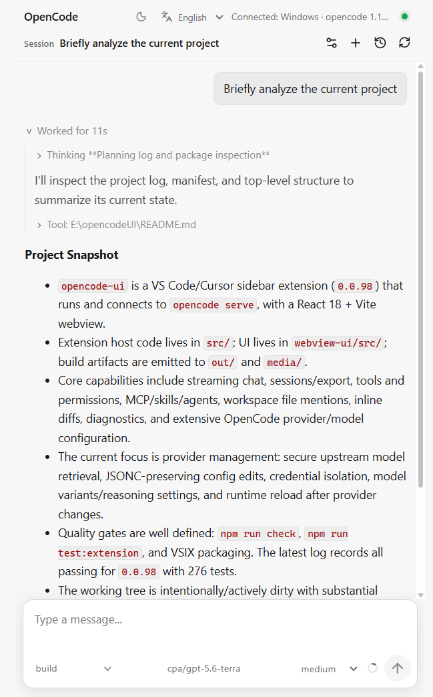
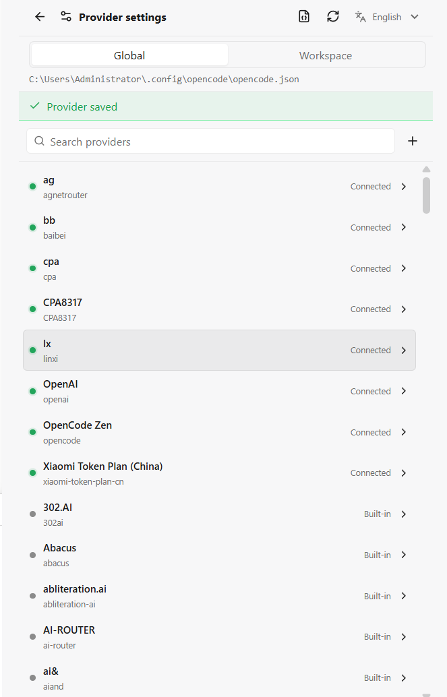
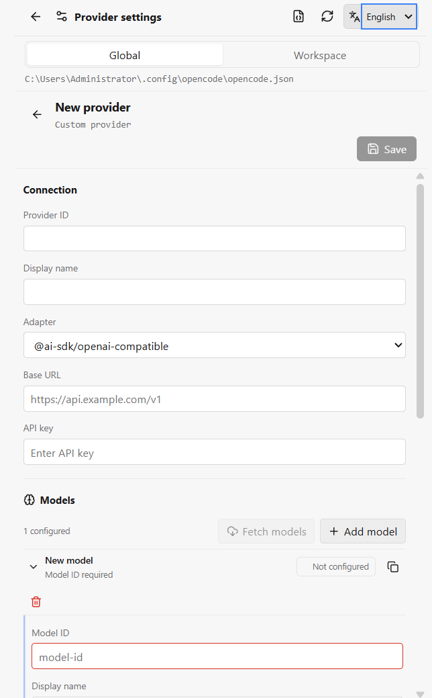
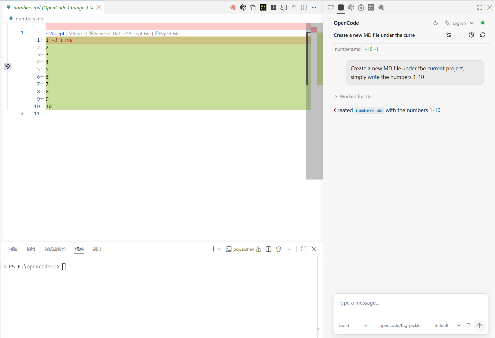

# opencode-ui

English | [简体中文](./README.zh-CN.md)

[](https://marketplace.visualstudio.com/items?itemName=tiyuhujiao.opencode-ui-vscode)
[](https://github.com/tiyuhujiao/opencodeUI/releases/latest)
[](./LICENSE)

OpenCode is powerful, but using it should not mean constantly moving between the editor, terminal, and configuration files. We built `opencode-ui` to give OpenCode a clear visual home inside VS Code, so conversations, tools, model choices, and code changes stay close to the work they belong to.

Version `1.0.22` supports both the OpenCode v1 server API and the OpenCode v2 API. The extension detects the API at runtime, so the same sidebar workflow continues to work when you upgrade from OpenCode v1 to v2. Compatibility has been verified against OpenCode `2.1.4`.

## Preview



## Supported Platforms

| Host environment | Supported modes |
| --- | --- |
| Windows | Local |
| Linux | Local, Remote-SSH, and other Linux remote hosts |
| macOS | Local on Apple Silicon or Intel, Remote-SSH, and other macOS remote hosts |
| WSL | Remote-WSL |

The extension runs in VS Code, Cursor, and compatible VS Code hosts. Install the OpenCode CLI in the same local or remote environment where the extension runs.

## macOS Support

Use the same sidebar workflow on macOS without extra extension settings. Install OpenCode with its official installer, Homebrew, npm, Bun, pnpm, Yarn, Mise, or MacPorts; `opencode-ui` will resolve the usual CLI locations even when VS Code was opened from Finder and received a shorter shell `PATH`.

## OpenCode V1 And V2 Compatibility

The extension automatically probes the running OpenCode server and adapts sessions, streaming events, tools, permissions, question forms, providers, models, agents, commands, skills, MCP servers, exports, diffs, reverts, and forks for the detected API. Managed v2 servers receive a generated password automatically and use OpenCode's Basic authentication contract.

When attaching to a v2 server that was started outside the extension, expose the same password to the extension process through `OPENCODE_PASSWORD` or the legacy `OPENCODE_SERVER_PASSWORD` name.

## Core Highlights

### Quick Custom Providers

Connect built-in providers or create your own directly in VS Code. The visual editor supports multiple models, reasoning levels, context and output limits, pricing, headers, credentials, and upstream model discovery, while keeping advanced configuration available when you need it.

| Browse and manage providers | Create a provider quickly |
| --- | --- |
|  |  |

### Inline Diff In VS Code

Review OpenCode edits where they matter: inside the editor. Added and removed lines are shown as an inline diff, with controls to accept or reject a hunk, a file, or the complete change set.



### English And Simplified Chinese

Switch the interface between English and Simplified Chinese at any time. Settings, prompts, dialogs, and status feedback follow your language choice, while familiar technical terms such as `Thinking` and `Tools` stay recognizable.

## What You Can Do

- Chat with OpenCode in the VS Code sidebar with streaming text, `Thinking`, tool activity, subtasks, todos, permissions, and questions.
- Create and manage providers and models without hand-editing every configuration field.
- Review code edits with inline diff controls before accepting them.
- Work with sessions, history, export, undo/redo, files, images, MCP servers, skills, and agents.
- Use the extension on macOS, Windows, Linux, Remote-WSL, and Remote-SSH Linux/macOS hosts. Cursor and other compatible VS Code hosts are supported too.

## Before You Start

Install either OpenCode v1 or v2 in the same local or remote environment where VS Code runs the extension:

```bash
opencode --version
```

That is the only required runtime dependency. `opencode-ui` will find the CLI, start `opencode serve`, detect the API version, and configure server authentication when needed. The v2 API and security model are documented at [OpenCode v2 docs](https://opencode.ai/v2/docs/).

## Install

**From VS Code Marketplace**

Open Extensions in VS Code, search for **opencode-ui**, and install the extension published by **tiyuhujiao**. You can also open the [Marketplace page](https://marketplace.visualstudio.com/items?itemName=tiyuhujiao.opencode-ui-vscode) directly.

**From GitHub Releases**

Download the latest `.vsix` from [GitHub Releases](https://github.com/tiyuhujiao/opencodeUI/releases/latest), then run **Extensions: Install from VSIX...** in VS Code.

## Feedback

Ideas, bug reports, and UI suggestions are very welcome. Please [open an issue](https://github.com/tiyuhujiao/opencodeUI/issues) so we can keep improving the extension together. If `opencode-ui` makes your OpenCode workflow a little easier, consider giving the project a star.

## License

MIT. See [LICENSE](./LICENSE).
